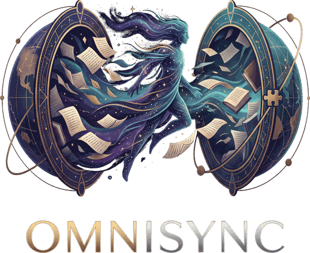

<div align="center">
  
  
  <h1>Real-time Sync Obsidian</h1>

  <p>
    <a href="README.md">English</a> | <strong>Español</strong>
  </p>

  <p>
    📖 <strong>Guía de Usuario:</strong> <a href="docs/Gu%C3%ADa%20de%20Usuario.md">Español</a> &bull; <a href="docs/User_Guide_EN.md">English</a>
    &nbsp;&bull;&nbsp;
    🛠️ <strong>Guía de Desarrolladores:</strong> <a href="docs/Gu%C3%ADa%20de%20Desarrolladores.md">Español</a> &bull; <a href="docs/Developer_Guide_EN.md">English</a>
  </p>

  <p>
    
    
    
    
    
    <a href="docs/TESTS_AND_AUDITS.md"></a>
    
  </p>
</div>

---

### ⚡ ¿Por qué OmniSync cambia las reglas del juego?

La mayoría de opciones para sincronizar Obsidian te obligan a elegir entre tres compromisos incómodos:
1. Pagar suscripciones mensuales recurrentes ($4 a $10/mes).
2. Confiar tus notas personales o de trabajo a nubes de terceros (Dropbox, Google Drive, OneDrive).
3. Configurar y pagar el mantenimiento de un servidor propio (CouchDB / Docker en un VPS).

**OmniSync elimina esa disyuntiva por completo.** Convierte tus dispositivos en pares directos (P2P). La información viaja cifrada de tu ordenador a tu móvil mediante canales directos de alta velocidad, sin intermediarios husmeando en tus datos.

---

## 🌟 Características Principales y Diferenciadores

### ⚡ 1. Sincronización en Tiempo Real Gratis (Estilo Google Docs)
* **Tiempo real y gratis:** Tus notas se sincronizan entre tus dispositivos al instante mientras escribes, sin suscripción y sin pagar nada.
* **Cursores y selecciones en vivo:** Gracias a la integración profunda con el motor **CodeMirror 6**, ves el cursor del otro dispositivo moviéndose en tiempo real sobre la misma nota.
* **Escritura simultánea:** Escribe a cuatro manos en la misma nota o edita desde tu teléfono mientras ves los cambios aparecer al instante en tu laptop.
* **Fusión Inteligente de 3 Vías:** Si ambos dispositivos editan sin conexión a internet, OmniSync reconcilia los cambios a nivel de carácter usando snapshots base. **Nunca se sobreescriben tus textos ni se generan molestos archivos duplicados de conflicto**.

### 🥷 2. Cero Cuentas, Cero Servidores Centrales, Cero Logs
* **Privacidad Absoluta:** No necesitas crear cuentas, ingresar correos electrónicos ni recordar contraseñas.
* **Cero Conocimiento (Zero-Knowledge):** Todo el contenido y las rutas de tus archivos se cifran localmente con **AES-256-GCM** antes de tocar la red.
* **Ofuscación de Rutas con HMAC:** Los nombres de tus notas y carpetas no viajan legibles. Un observador de red solo ve bloques de datos cifrados sin saber qué notas tienes ni cómo se llaman.
* **Sin logs en tránsito:** Al usar WebRTC directo y relays efímeros (Nostr o tu propio Worker Serverless), ningún servidor almacena historiales de tus sesiones ni registros de quién eres.

### 📲 3. Vinculación Instantánea por Código QR (Sin Complicaciones)
* Olvídate de copiar tokens de GitHub, endpoints de S3 o complejas credenciales en pantallas táctiles.
* Abre el asistente de vinculación en tu ordenador, **escanea el código QR con tu móvil** y confirma en pantalla.
* Se establece un intercambio de claves efímero **ECDH P-256** protegido por un token de un solo uso con caducidad de 2 minutos. En 5 segundos tus dispositivos están sincronizados.

### 🔄 4. Sincronización Asíncrona Inteligente (Móvil Apagado o Sin Red)
* Tu móvil no necesita estar encendido ni abierto para que sincronices en el escritorio.
* Las notas modificadas se resguardan cifradas en un buzón de paso (en relays públicos de Nostr o en tu propio **Cloudflare Worker gratuito desplegable en 1 clic**). En el momento en que tu teléfono se conecte, se pone al día automáticamente.

> **⚠️ OmniSync no es un backup.** Los avisos del buzón caducan en 7 días; los blobs de R2 en 10 días; los blobs de Blossom público en ≈7 días. Es una capa de tránsito en tiempo real, no almacenamiento permanente. Cada dispositivo conserva su propia bóveda. Para una copia de seguridad real, combínalo con iCloud, Dropbox, una copia manual o Obsidian Sync.

### 📦 5. Soporte Nativo para Archivos Grandes (Imágenes, PDFs, Audio)
* A través del protocolo **Blossom (BUD-01/02)** direccionado por hash criptográfico SHA-256, los archivos multimedia pesados se transfieren eficientemente sin saturar la memoria ni degradar el rendimiento de la bóveda.

### 🛡️ 6. Protección contra Pérdida de Datos (Papelera Segura)
* Si un archivo se borra en un dispositivo remoto, OmniSync **nunca lo destruye físicamente de tu disco**: lo mueve de forma segura a la Papelera nativa de Obsidian (`.trash`), permitiéndote recuperarlo en cualquier momento ante cualquier equivocación humana.

---

## 📊 Comparativa Rápida Frente a Alternativas

| Característica | 🔮 **OmniSync** | 💎 **Obsidian Sync** | ☁️ **Remotely Save** | 🗄️ **Self-hosted LiveSync** |
| :--- | :---: | :---: | :---: | :---: |
| **Tiempo Real (Colaboración en Vivo)** | ✨ **Sí (CodeMirror 6)** | ❌ No (Delay/Guardado) | ❌ No (Polling) | ⚡ Sí (CouchDB) |
| **Cuentas o Registro Requerido** | 🥷 **Ninguno (0 datos)** | 📧 Requiere Cuenta y Email | 🔑 Requiere cuenta en la nube | 👤 Requiere credenciales de BD |
| **Arquitectura de Red** | ⚡ **P2P Directo (WebRTC)** | 🏢 Servidor Central | ☁️ Nube Comercial (S3/Dropbox) | 🖥️ Servidor Docker/VPS Propio |
| **Coste Económico** | 🎁 **100% Gratis** | 💳 $4 – $10 / mes | 🟡 Coste de Cloud Storage | 🟡 $3 – $6 / mes en VPS |
| **Emparejamiento Móvil** | 📲 **Escanear QR (2 seg)** | 🔑 Usuario y contraseña | ⚙️ Configurar claves API | ⚠️ Configuración técnica compleja |
| **Cifrado de Nombres de Archivo** | 🛡️ **Sí (HMAC Ofuscado)** | 🔒 Sí (si activas clave) | ❌ Nombres visibles en la nube | 🛡️ Sí |

*(Consulta la [Comparativa Técnica Completa](docs/COMPARATIVA_es.md) para un análisis a fondo de arquitectura).*

---

## 🚀 Instalación Rápida

> *OmniSync se encuentra actualmente en proceso de validación oficial para el directorio de la comunidad de Obsidian. Mientras tanto, puedes instalarlo manualmente en 1 minuto:*

1. Ve a la sección de **[Releases](https://github.com/abismalmx/OmniSync/releases)** y descarga los archivos:
   - `main.js`
   - `manifest.json`
   - `styles.css`
2. En tu carpeta de Obsidian, entra a la ruta `.obsidian/plugins/` y crea una carpeta llamada `omnisync/`.
3. Pega los 3 archivos descargados dentro de `.obsidian/plugins/omnisync/`.
4. Abre Obsidian y dirígete a: **Ajustes → Plugins de la comunidad** y activa **OmniSync**.
5. Abre **Ajustes → OmniSync → Asistente de Vinculación** para conectar tu teléfono u otro ordenador en segundos.

Para instrucciones paso a paso detalladas con capturas, revisa la **[Guía de Usuario](docs/Gu%C3%ADa%20de%20Usuario.md)**.

---

## 🔒 Privacidad y Transparencia

- **¿Qué ve el relay público?** Únicamente que existe una conexión cifrada y el tamaño aproximado de los paquetes de datos. No puede leer tus notas ni los títulos.
- **¿Quieres independencia 100% total?** OmniSync incluye un asistente integrado para desplegar tu propio **Cloudflare Worker gratuito en 1 clic**, eliminando la dependencia de relays públicos.
- **Auditorías de Seguridad:** El código incluye suites exhaustivas de pruebas de seguridad y análisis criptográfico (`npm test`). Consulta los informes en [docs/TESTS_AND_AUDITS_es.md](docs/TESTS_AND_AUDITS.md).

---

## 🛠️ Desarrollo Local

```bash
# Clonar el proyecto
git clone https://github.com/abismalmx/OmniSync.git
cd OmniSync

# Instalar dependencias
npm install

# Compilar en modo desarrollo (watch)
npm run dev

# Compilar para producción
npm run build

# Ejecutar tests de seguridad y sincronización
npm test
```

Consulta la **[Guía de Desarrolladores](docs/Gu%C3%ADa%20de%20Desarrolladores.md)** para detalles sobre la estructura de directorios, protocolos y contribuciones.

---

## 📄 Licencia

Publicado bajo la licencia **[PolyForm Noncommercial 1.0.0](LICENSE)** — Libre y gratuito para uso personal, aprendizaje, organizaciones sin fines de lucro e investigación académica.

---

<div align="center">
  Creado con dedicación por <strong>abismalmx</strong>.<br>
  <em>Si OmniSync te ahorra una suscripción mensual, compártelo con la comunidad.</em>
</div>
